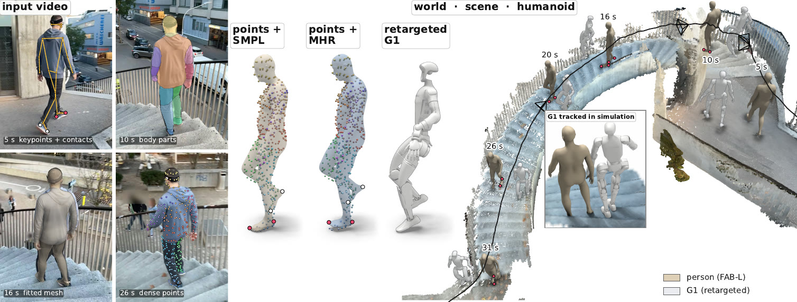

# FAB: Fast and Accurate Body Estimation



FAB predicts 2D / 3D keypoints and dense surface points of every person in an image, then fits SMPL to them. It also
predicts foot, hand and knee contacts, body parts and Unitree G1 joint angles. From a video it recovers the motion in a
metric world, reconstructs the scene and retargets the motion to a G1 robot. FAB-L reaches **32.7 mm 3DPW PA-MPJPE**
at **39 fps** end to end on one RTX 4070 Ti SUPER. [Project page][page] · [Paper (arXiv)][paper]

**Hands:** see the companion model FAH ([project page](https://www.jinkuncao.com/FAH/) · [code](https://github.com/noahcao/FAH)).

## Install

Python 3.10+ and PyTorch 2.4+.

```bash
git clone https://github.com/noahcao/FAB.git && cd FAB
python3 -m venv .venv && source .venv/bin/activate        # or: uv venv, then uv pip install
pip install torch torchvision --index-url https://download.pytorch.org/whl/cu128
pip install -e ".[retarget,world]"                         # other extras: eval, train, engine
```

Then fetch four sets of files. They go under `~/.cache/fab` (set `$FAB_HOME` to change it).

1. **FAB weights** (the released models; every command uses them by default):
   ```bash
   hf download noahcao/FAB --local-dir ~/.cache/fab/weights
   (cd ~/.cache/fab/weights && sha256sum -c SHA256SUMS)       # macOS: shasum -a 256 -c SHA256SUMS
   ```
   To use other weights: `$FAB_WEIGHTS` or `--weights DIR`.
2. **SAM 3D Body config and MHR model** (the config only; FAB's `model.pt` files hold all weights): accept the
   [SAM licence](https://huggingface.co/facebook/sam-3d-body-dinov3) on Hugging Face, run `hf auth login`, then
   `python -c "import fab; fab.download_sam3d()"` (`$FAB_SAM3D` changes the folder).
3. **SMPL:** register at [smpl.is.tue.mpg.de](https://smpl.is.tue.mpg.de), download SMPL 1.1.0 for Python, then run
   `bash scripts/download_body_models.sh /path/to/SMPL_python_v.1.1.0` (`$FAB_SMPL_DIR` changes the `smpl/` folder).
   The script warns if your `SMPL_NEUTRAL.pkl` differs from the one behind the paper's numbers.
4. **Unitree G1 description** (for the G1 head and retargeting): `bash scripts/download_g1.sh`

No GPU? `FABPredictor(..., device="cpu", fast=False)` works in Python, slowly; the commands and `fast=True` need CUDA.

## Quick start

```bash
fab assets/demo/skater_seated.jpg --out output/fab               # one image
fab-video assets/demo/dancer_street.mp4 -o output/dancer.mp4     # a video
fab-world assets/demo/steps_up.mp4 --out output/world            # world motion + scene
fab-retarget output/world/steps_up.npz --out output/g1           # G1 motion on that scene
```

- `fab-retarget --mode mesh` or `--mode skeleton` retargets from the fitted mesh or the joints instead of the dense points.
- `fab-retarget-ee` places the robot's hands and feet where the person's were, on a flat floor ([retarget_ee](docs/retarget_ee.md)).
- `fab-world` needs static, textured surroundings within about 8 m of the camera.

## Outputs

| command | writes | contents |
|---|---|---|
| `fab` | `<out>/<name>_fab.pkl` | per person: keypoints, dense points, MHR and SMPL meshes, contacts, G1 angles, parts ([usage](docs/usage.md)) |
| `fab-video` | `<out>.mp4`, `<out>.jpg`, `<out>.pkl` | a render, a poster frame, per-frame results with tracks, smoothed outputs and video contacts |
| `fab-world` | `<out>/<name>.npz`, `_scene.ply`, `_hfield.npz` | cameras, the world SMPL body, contacts; scene mesh and heightfield ([world](docs/world.md)) |
| `fab-retarget` | `<out>/<name>_g1.npz` + `.json` | G1 joint angles and root pose at 50 fps ([retarget](docs/retarget.md)) |

## Models

| model | `--model` | encoder | 3DPW PA-MPJPE / MPJPE (mm) | fps, one person |
|---|---|---|---|---|
| FAB-S | `fab-s` | DINOv3 ViT-S+/16 | 37.7 / 59.8 | 63.8 |
| **FAB-L** (default) | `fab-l` | DINOv3 ViT-L/16 | 32.7 / 53.1 | 39.2 |
| FAB-H (MHR mesh → SMPL) | `fab-h` | DINOv3 ViT-H+/16 | 33.1 / 53.2 | 24.9 |

fps: person detection to fitted SMPL on an RTX 4070 Ti SUPER with TensorRT engines ([acceleration](docs/acceleration.md);
FAB-H: compiled PyTorch). FAB-H fits SMPL to its MHR mesh (MHR mesh → SMPL; `--profile points`: dense points → SMPL,
[usage](docs/usage.md)) and has no contact, part or G1 head.

## Documentation

[Usage](docs/usage.md) (Python API, outputs, options) · [World](docs/world.md) · [Retarget](docs/retarget.md) ·
[Retarget-EE](docs/retarget_ee.md) · [Contact](docs/contact.md) · [Acceleration](docs/acceleration.md) ·
[Training](docs/training.md) ([data format](docs/training_data.md)) · [Evaluation](docs/evaluation.md) · [Reproduce the paper](docs/reproduce.md) ·
[Datasets](datasets/README.md) · [Troubleshooting](docs/troubleshooting.md)

## Licence

- **Code:** [Apache 2.0](LICENSE), except the SAM 3D Body-derived files (SAM License) and the vendored DINOv3 code
  (DINOv3 License) listed in [NOTICE](NOTICE) and [THIRD_PARTY_NOTICES.md](THIRD_PARTY_NOTICES.md).
- **Weights** (all of them, detector and SMPL fitters included): [WEIGHTS_LICENSE](WEIGHTS_LICENSE), research and
  non-commercial use only; SAM, DINOv3 and detector upstream terms apply.
- **Downloads** (SMPL, SAM 3D Body config, MHR, the G1 description, the world-mode tools) come under their own
  licences ([THIRD_PARTY_NOTICES.md](THIRD_PARTY_NOTICES.md)). No dataset is redistributed.
- **Demo media** in `assets/` keep their own licences ([assets/CREDITS.md](assets/CREDITS.md)); the teaser shows EMDB frames.

## Citation

```bibtex
@misc{fab2026,
  title         = {Fast and Accurate Body Estimation in Pixels, World Space and Scenes},
  author        = {Cao, Jinkun},
  year          = {2026},
  eprint        = {2611.25801},
  archivePrefix = {arXiv},
  primaryClass  = {cs.CV},
  url           = {https://arxiv.org/abs/2611.25801}
}
```

FAB builds on SAM 3D Body, DINOv3, MHR and SMPL; world mode uses ViPE, UniDepth, GeoCalib, MoGe, COLMAP and
Mask2Former; the detector was trained with Ultralytics YOLO on SAM 3 labels; the G1 model is Unitree's, with mjlab's
collision capsules and MuJoCo physics. Links and licences: [THIRD_PARTY_NOTICES.md](THIRD_PARTY_NOTICES.md).

[page]: https://www.jinkuncao.com/FAB
[paper]: https://arxiv.org/abs/2611.25801
