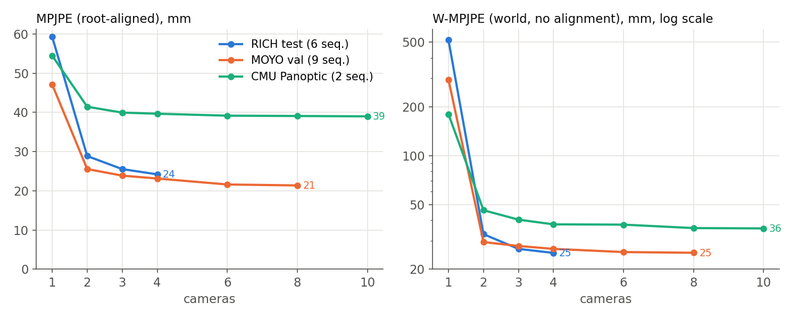

# Multi-view fusion: `fab-multiview`

`fab-multiview` recovers one person's motion from several synchronised, calibrated cameras. It runs the released FAB
model on every view and fuses the views with the model's own visibility predictions. The output uses `fab-world`'s
layout in the rig's world, so [`fab-retarget`](retarget.md) runs on it unchanged.

```bash
fab-multiview rig.json --out output/mv                       # every camera in rig.json
fab-multiview take/ --out output/mv                          # a take folder (below)
fab-multiview rig.json --out output/mv --views cam0,cam2     # some of the cameras
fab-multiview rig.json --out output/mv --subject_boxes boxes/ # pick the person: boxes/<camera name>.npz
fab-retarget output/mv/<name>.npz --out output/g1            # the G1 motion, as for fab-world
```

| option | default | effect |
|---|---|---|
| `--out`, `--name` | `output/fab_multiview`, the rig file's (folder's) name | output folder, clip name |
| `--views` | all | comma-separated camera names |
| `--subject_boxes` | the rule below | a folder of `<camera name>.npz`, `box` (T, 4) xyxy per synced frame, NaN = unknown (identity only) |
| `--model` | `fab-l` | `fab-l` or `fab-s` (the fusion needs the dense head) |
| `--fast` | off | FAB's compiled path (`fast=True`); the default is the eager path |
| `--trackers` | off | world-space trackers, `<body point>=<file>[,...]` ([Optional: tracker input](#optional-tracker-input)) |

## The rig

**`rig.json`**, paths relative to the file:

```json
{"fps": 30, "up": [0, 0, 1], "floor_z": -0.95,
 "cameras": [{"name": "cam0", "frames": "cam0/", "K": [fx, fy, cx, cy], "T_world_cam": [[...4 x 4...]],
              "dist": [k1, k2, p1, p2, k3], "timestamps": "cam0/times.npy", "offset": 0.0},
             {"name": "cam1", "video": "cam1.mp4", "K": [[fx, 0, cx], [0, fy, cy], [0, 0, 1]], "T_world_cam": [[...]]}]}
```

- `frames` (a folder of images, sorted by name) or `video`; `K` as `[fx, fy, cx, cy]`, a 3 x 3 matrix or
  `{"fx", "fy", "cx", "cy"}`; `T_world_cam` maps camera points (OpenCV axes: x right, y down, z forward) to the world.
- `dist` (optional): OpenCV distortion; frames are undistorted to the pinhole `K` before FAB runs.
- `timestamps` (optional): a `.npy` or text file with one time per frame in seconds (or rows `t, frame number`);
  `offset` (seconds) is added to them. Without timestamps, frame i is at `i / fps + offset`.
- `up` (default `[0, 0, 1]`): the world's up direction; the output world is turned so that it is +z.
  `floor_z` (optional): the floor height along `up`; without it, the floor is the 10th percentile of the body's lowest
  point over the clip.

**A take folder** holds `world.json` (`cameras.<folder>.K` and `.T_world_cam`, optional `floor_z`) and one folder of
frames per camera, each with an optional `frame_index.npy` (rows `t, frame number`).

Frames are matched to the first camera's timeline: each camera's nearest frame within half a frame period, else none.

## What it does

1. **Per view:** `FABPredictor` with its released defaults and the camera's `K` (video mode: detector every 10 frames,
   boxes tracked in between), every person.
2. **The subject:** on the first frame, the cross-view match (one person in each of two views) whose triangulated
   keypoints reproject within 5 % of the person's height, the most prominent such match (summed 2D height). After that,
   in each view, the person nearest the projection of the subject's previous 3D keypoints (within 25 % of their height).
   A subject lost in every view is picked again by the first rule. `--subject_boxes` overrides this per view and frame.
3. **Fusion, per frame:**
   - The 70 MHR keypoints and 14 joints are triangulated from their 2D. Every view that sees the person takes part,
     weighted by the visibility head's P(visible) (at least 0.05). A view whose ray passes more than 5 cm from the point
     is dropped while more than two remain. A point with fewer than two views, or with two views that disagree, is not
     triangulated.
   - Each view's dense points and joints are placed on the triangulated joints by a robust similarity (scale,
     rotation, translation). This removes the view's monocular depth and size error. A frame with fewer than 6
     triangulated joints reuses the view's nearest-in-time placement. Then each dense point moves by the residual of its
     nearest joint on the SMPL template (triangulated minus placed), which corrects the view's limb poses.
   - Each of the 468 dense points and 14 joints is the robust weighted mean over the views (Geman-McClure, 5 cm). A
     point's weight in a view is the P(visible) of its nearest joint on the SMPL template (at least 0.05). A
     triangulated joint keeps its triangulated position.
4. **The floor** (only with the rig's `floor_z`): each support part's fused points (those nearest its joint on the SMPL
   template) are checked against the floor, within 20 cm. A knee or hand that the image contact head puts on the floor
   (static contact >= 0.5 in the view that sees its keypoint best) is moved vertically so that its lowest point is on the
   floor. A foot is only kept from going below the floor, never pulled down: shoes add their soles. The fit treats the
   moved points as any other target.
5. **SMPL:** one fit per frame to the fused points. The released one-pass fitter runs first, then two of the release's
   Gauss-Newton steps (robust, weighted by the fused confidence). The clip's median betas follow, then two more steps
   with that shape fixed. The release's world smoothing comes last (rotations sigma 2, pelvis sigma 3 frames at 30 fps, i.e. 67 / 100 ms at any frame rate).
6. **Contacts:** the release's labels on the flat floor (lowest vertex within 4 cm, slower than 0.5 m/s), and the image
   contact head's probabilities fused over the views (weights: the P(visible) of the heel, toe, wrist or knee).

With one camera there is nothing to fuse: the output is the release's own single-view result (FAB's per-frame SMPL fit,
mapped into the world by the camera's `T_world_cam`, the clip's median betas and the release's world smoothing).

## More cameras

Error against ground truth as cameras are added, on public multi-view datasets (fab-multiview at its defaults: FAB-L,
eager). For each number of cameras k: up to 10 random k-subsets of a sequence's cameras (all of them when there are
fewer), averaged per sequence and then over sequences. k = 1 is the release's single-view result placed with the
calibration. Joints: FAB's 14 evaluation joints (the H36M regressor) on the predicted and the ground-truth SMPL meshes;
MPJPE root-aligned at the mid-hip, W-MPJPE in the dataset's world without any alignment.



| dataset | cameras used | MPJPE, k = 1 / 2 / 3 / 4 / all (mm) | W-MPJPE, k = 1 / 2 / 3 / 4 / all (mm) |
|---|---|---|---|
| RICH test, 6 sequences, 30 fps | 4 | 59.3 / 28.9 / 25.5 / 24.2 / 24.2 | 514 / 32.8 / 26.7 / 25.2 / 25.2 |
| MOYO val, 9 sequences, 3 fps | 8 | 47.1 / 25.6 / 23.9 / 23.1 / 21.4 | 294 / 29.4 / 27.8 / 26.7 / 25.2 |
| CMU Panoptic, 2 sequences, 30 fps | 10 | 54.5 / 41.5 / 40.0 / 39.7 / 39.0 | 180 / 46.1 / 40.4 / 37.8 / 35.7 |

- One camera recovers the pose well but not its place: the world error is the monocular depth error, up to metres for
  people far from the camera. A second camera removes most of it.
- Two cameras facing each other (about 180 degrees apart) triangulate poorly: MOYO's most-spread pair gives 56.9 mm
  MPJPE against 25.6 mm for random pairs. Cameras 60-120 degrees apart work best.
- Ground truth: RICH's SMPL-X fits mapped to SMPL topology with MHR's public SMPL-X -> MHR -> SMPL maps; MOYO's SMPL
  fits. RICH's floor comes from a plane fit to the scene scan; MOYO's frames are its released every-10th-frame set.
- CMU Panoptic's ground truth is 3D keypoints, so its rows score 13 joints (hips, knees, ankles, neck, shoulders, elbows,
  wrists) of the predicted SMPL skeleton against them by name; its plateau includes the 1-5 cm offset between the two
  joint definitions. Its sequences have cameras all around the person (a one-sided rig is left out of the pooled row).

## Outputs

As `fab-world` ([world.md](world.md#outputs)), in the rig's world (z up, metres):

| file | contents |
|---|---|
| `<out>/<name>.npz` | `frames`, `fps`, `pose` (T, 72), `betas` (10,), `trans` (T, 3), `joints` (T, 24, 3), `valid` (T,), `contacts` (JSON); `T_world_cam` / `K` of the first camera, `T_world_cams` (N, 4, 4), `K_cams`, `camera_names`, `timestamps`, `floor_z`, `notes` |
| `<out>/work/joint/recon/<name>.npz` | the same + `verts` (T, 6890, 3); `_hfield.npz` and `_scene.ply`: the flat floor |
| `<out>/work/ours/fab/<name>_raw.npz` | the fused dense points `pts` (T, 468, 3) (`fab-retarget`'s points mode) |
| `<out>/work/contacts/<name>__0.contact.npz` | the fused image contact probabilities (`fab-retarget --ground_aware`) |
| `<out>/work/views/<camera>.pkl`, `<out>/work/<name>_fusion.npz` | each view's FAB outputs (reused by a re-run with the same frames, model and `--fast`) and the fusion's per-frame record (subject per view, triangulated keypoints, placements) |

`valid` marks frames where the subject was seen; the body is interpolated in between.

## Getting good results

- The calibration bounds the accuracy: a camera pose off by 2 cm moves the triangulated joints by about that much.
- Views that see the person from different sides (60-120 degrees apart) triangulate best. Two cameras that both see only
  the person's back, or a joint that only one camera sees, give that view's monocular estimate for the joint.
- The rig's world should have z up and a known floor (`up`, `floor_z`) for `fab-retarget`.
- FAB's body is barefoot: with thick soles, planted feet sit at the sole's height above the floor (about 4 cm with
  sneakers in our tests). `fab-retarget --ground_aware` holds planted feet on the floor with the fused contact
  probabilities.
- With two views, a joint whose 2D is wrong along the epipolar line in one view (e.g. a knee hidden behind the hands)
  still triangulates consistently and cannot be detected; a third camera removes this.

## Optional: tracker input

World-space trackers, such as VIVE trackers on the hands, wrists or pelvis, can be fused with the views (two or more
cameras). This is off unless `--trackers` is given. Without it, `fab-multiview` is unchanged.

```bash
fab-multiview take/ --out output/mv --trackers left_wrist=left.npz,right_wrist=right.csv
```

**Input.** One file per tracker, mapped to a body point: `pelvis`, `chest`, `head`, `left_wrist` / `right_wrist`
(also `left_hand` / `right_hand`), `left_foot` / `right_foot` (also `left_ankle` / `right_ankle`). Times are on the rig's
clock, the same one as the camera timestamps (or `i / fps + offset`). Poses are in the rig's world, before the `up` turn.

| file | contents |
|---|---|
| `.npz` | `t` (N,) seconds, `xyz` (N, 3) metres; optional `quat` (N, 4) wxyz (tracker -> world) and `valid` (N,) bool |
| `.csv` | a header `t,x,y,z`, optional `qw,qx,qy,qz` and `valid` (0 / 1), then one row per sample |

**What it does** (`fab/multiview_trackers.py`). After the fusion, one batch smoother runs over the whole clip. Its
solution is the one a Rauch-Tung-Striebel smoother gives. The SMPL fit and the export then run as above, so
`fab-retarget` runs unchanged.
- **State:** every target point of the fit (the 468 dense points and the 14 joints) at every frame. The motion prior is
  constant velocity (white acceleration, 10 m/s^2).
- **The views:** each view's points as the fusion places them. Each has an anisotropic covariance: 8 cm along that
  camera's ray (monocular depth) and 2 cm across it, divided by the view's weight (P(visible)). The floor rule above
  applies to the views' per-frame means.
- **A tracker** carries the points rigid with its body segment: the dense points on that SMPL part (e.g. the hand) and
  its joints (e.g. the wrist). Each point has one static offset in the tracker's frame, estimated together with the
  trajectories from the tracker's own frames. The tracker's covariance is 3 mm. In the SMPL fit, these points weigh
  (2 cm / 3 mm)^2 times their sample's weight: the tracker's information over a view's. The fit therefore follows the
  tracked segment.
- **Without a quaternion,** the segment's rotation comes from the views.
- **Robustness:** samples flagged invalid, non-finite, or repeating the previous pose bit for bit (frozen) are dropped.
  A frame's pose is interpolated between the valid samples around it, across gaps of up to 0.1 s. Each sample is then
  weighted by its distance from the views' own estimate (Tukey's biweight, 15 cm). Lost, jumping or drifting samples
  therefore give way to the views. A drift below about 10 cm is not told apart from the views' own error.
- **Offsets:** they come from the views. A bias of the views that stays constant in the tracker's frame stays in them;
  the tracker removes the rest of the views' error on its segment.

`notes.trackers` in the output records, per tracker, how many samples were dropped, the share of frames with a pose and
with an accepted sample, and the estimated offset of its joint.
